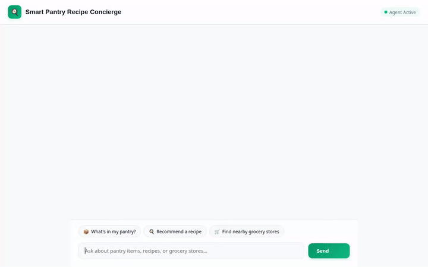

# Smart Pantry Recipe Concierge 🍳📦

An intelligent AI agent built with the **Google Agent Development Kit (ADK)** that helps users manage kitchen inventory, track pantry expiration dates, suggest customized recipes, locate nearby grocery stores, and generate rich visual media (photos & videos) with Google's Gemini models and A2UI cards.



---

## 🌟 Overview & Key Features

The **Smart Pantry Recipe Concierge** combines multi-modal AI generation with structured database management and location services to act as your complete kitchen assistant:

- **📦 Inventory & Pantry Management**: Read, add, and update item quantities in Google Cloud Firestore.
- **🍳 Recipe Suggestions & Online Search**: Recommends meals based on available ingredients and retrieves detailed cooking instructions via TheMealDB API.
- **🧠 Cross-Session Memory Bank**: Remembers dietary preferences, health goals, and food allergies across sessions using Vertex AI Memory Bank.
- **🎨 Dynamic A2UI Display Cards**: Emits structured UI components (cards, columns, rows, images) rendered natively in the chat interface via A2UI schema v0.8.
- **🖼️ Gemini Image Generation**: Generates studio food photographs of dishes and pantry items using `gemini-2.5-flash-image` and `gemini-3.1-flash-lite-image`.
- **🎥 Google Omni Video Generation**: Creates short food item videos using Google's `gemini-omni-flash-preview` in the global region, saved as ADK Playground artifacts and uploaded to Google Cloud Storage.
- **🛒 Nearby Grocery & Store Locator**: Geocodes street addresses and finds nearby supermarkets, bakeries, or specialty grocers via the Google Maps Places API (New searchNearby).
- **🐍 Code Sandbox Execution**: Executes Python data processing scripts inside an isolated Agent Engine Sandbox.

---

## 🛠️ Architecture & Google Cloud Services

- **Agent Development Kit (ADK)**: Core agent orchestrator powered by `gemini-2.5-flash`.
- **Google Cloud Firestore**: Persists pantry items, categories, quantities, and expiration dates.
- **Vertex AI Memory Bank**: Stores long-term user facts and allergy constraints across conversations.
- **Google Cloud Storage (GCS)**: Stores generated recipe images and Omni video files.
- **Google GenAI SDK (`google-genai`)**: Interacts with Imagen, Gemini Image, and Omni Video models.
- **Google Maps Platform**: Geocoding API & Places API (`places.googleapis.com/v1/places:searchNearby`).
- **A2UI Schema Manager (v0.8)**: Generates structured UI components for rich front-end rendering.
- **FastAPI Proxy Frontend**: Light python web proxy converting browser chat messages into A2A protocol events.

---

## 🚀 Setup & Local Execution Instructions

### Prerequisites
- Python 3.11+
- Node.js & npm (for Playwright demo recording)
- Google Cloud Project with Vertex AI, Firestore, and Cloud Storage enabled
- Google Maps API Key (`GOOGLE_MAPS_API_KEY`)

### 1. Installation
Clone the repository and install dependencies using `uv` or `pip`:
```bash
cd smart-pantry-agent
uv sync
```

### 2. Environment Variables
Create a `.env` file in the project root:
```ini
GOOGLE_CLOUD_PROJECT=your-gcp-project-id
GOOGLE_CLOUD_LOCATION=us-east1
GOOGLE_MAPS_API_KEY=your-google-maps-api-key
MEMORY_SERVICE_URI=agentengine://your-memory-bank-id
```

### 3. Running the Local Agent Frontend Proxy
Navigate to the `frontend/` directory and launch the proxy server:
```bash
cd frontend
uv run python main.py
```
*The proxy server runs on port 8080. Open your web browser to `localhost:8080` to interact with the Smart Pantry Recipe Concierge UI.*

---

## 🎥 Recording Demo Videos

To record a Playwright screen capture of the agent driving the UI with custom prompts and Lyria background music:
```bash
node .agents/skills/record-demo/record-agent.js \
  -q "What ingredients do I currently have in my pantry?" \
  -q "Suggest a quick recipe using my available ingredients" \
  --music "upbeat lo-fi chill hip-hop, warm Rhodes piano, gentle vinyl crackle, cheerful downtempo beat" \
  --wait 15000 \
  --speed 1.5 \
  -o agent_demo.webm
```

To convert the `.webm` video to an optimized, looping `.gif`:
```bash
ffmpeg -y -i agent_demo.webm -vf "fps=12,scale=720:-1:flags=lanczos,split[s0][s1];[s0]palettegen[p];[s1][p]paletteuse" demo.gif
```

---

## 📜 Project Structure

```
smart-pantry-agent/
├── app/
├── app/agent.py          # Root ADK Agent definition, system prompt, callbacks & tools
├── app/tools.py          # Firestore, Places API, GCS, Image & Omni Video tool definitions
├── app/a2ui_utils.py     # A2UI after_model_callback transformer
├── frontend/
├── frontend/main.py      # FastAPI A2A proxy server
├── frontend/static/      # Rebranded index.html chat frontend with prompt chips
├── demo.gif              # Embedded looping GIF of agent in action
├── agent_demo.webm       # WebM screen recording with Lyria soundtrack
├── agents-cli-manifest.yaml # agents-cli deployment manifest
└── pyproject.toml        # Project dependencies
```
